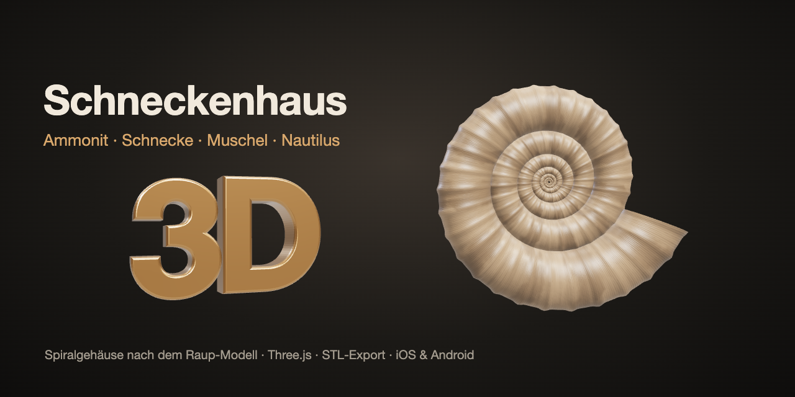
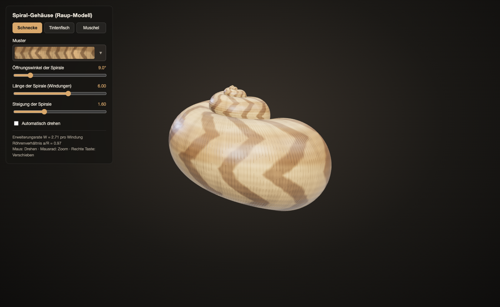
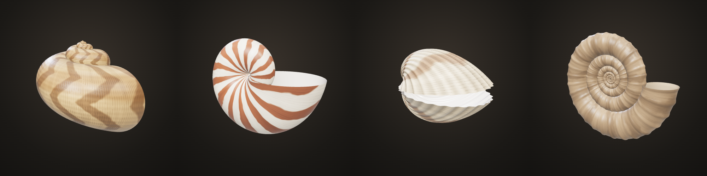
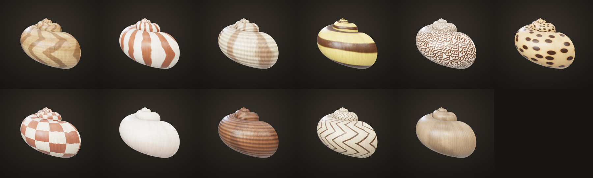
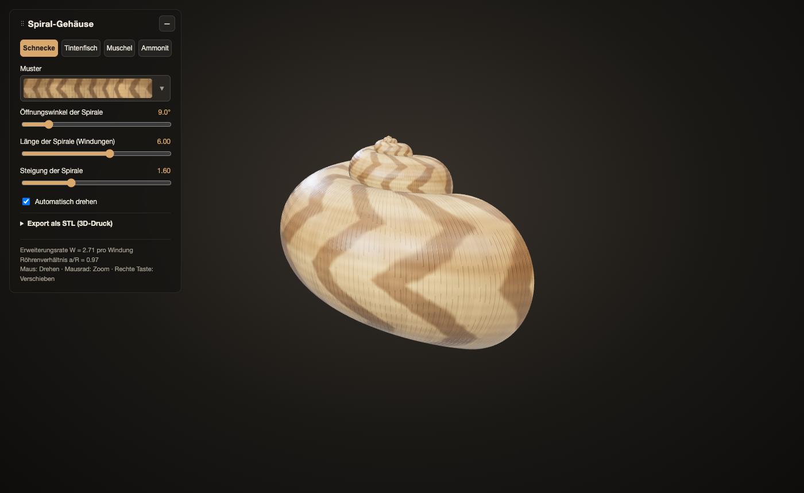

# Schneckenhaus 3D



Interaktive 3D-Spiralgehäuse von **Schnecke**, **Muschel**, **Nautilus (Tintenfisch)** und **Ammonit** im Browser, erzeugt mit [Three.js](https://threejs.org) nach dem Raup-Modell der Schalenwindung.

**▶ Live-Demo: [helmutqualtinger.github.io/schneckenhaus](https://helmutqualtinger.github.io/schneckenhaus/)**



## Funktionen

- **Drei Regler** für die Spiralgeometrie:
  - **Öffnungswinkel**: Winkel der logarithmischen Spirale; bestimmt die Erweiterungsrate W = e^(2π·tan ψ) pro Windung
  - **Länge**: Anzahl der Windungen; das Gehäuse wächst an der Mündung, die Spitze bleibt fest
  - **Steigung**: Verschiebung entlang der Windungsachse (0 = flach wie Nautilus, hoch = Turmschnecke)
- **Vier Grundformen** per Knopfdruck: Schnecke, Tintenfisch (Nautilus), Muschel (zwei gespiegelte Klappen), Ammonit (flache Spirale mit Querrippen)
- **11 prozedurale Schalenmuster** mit Farb- und Reliefkarte, wählbar über eine Vorschau-Palette
- Scharfe Spitze, perlmuttartig schimmernde Innenseite, Anwachslinien und Rippen als Relief
- Drehen, Zoomen und Verschieben mit Maus oder Touch
- **Export als STL** für den 3D-Druck: massiver, wasserdichter Körper mit Muster-Relief und Farben pro Dreieck
- **Als App installierbar** auf iOS und Android (Progressive Web App), funktioniert danach auch offline

## Formen



## Muster



| | | | | |
|---|---|---|---|---|
| Zickzack-Flammen | Tigerstreifen (Nautilus) | Herzmuschel-Rippen | Bänderschnecke | Zeltmuster (Kegelschnecke) |
| Leopardenpunkte | Würfelmuster | Porzellanweiß | Dunkel gerippt | Feine Wellenlinien |
| Fossil (Ammonit) | | | | |



## Export als STL (3D-Druck)

Im Bedienfeld unter **Export als STL** lässt sich die aktuelle Form mit dem gewählten Muster als binäre STL-Datei herunterladen.

| Einstellung | Bedeutung |
|---|---|
| Größe (mm) | längste Kante des Modells |
| Wandstärke (mm) | Dicke der Schale; zur Spitze hin automatisch dünner, damit sich die Röhre nicht selbst durchdringt |
| Relieftiefe (mm) | wie stark das Muster (Anwachslinien, Rippen) als Relief nach außen ausgeprägt wird |
| Auflösung | Entwurf (ca. 0,4 Mio. Dreiecke), Standard (ca. 1,4 Mio.), Fein (ca. 3,5 Mio.) für die Schnecke mit 6 Windungen |

Die Datei ist ein geschlossener, wasserdichter Körper (Außenfläche, Innenfläche, Mündungsrand) in Millimetern mit Z nach oben, auf z = 0 gestellt. Die Musterfarben stehen pro Dreieck in der Datei (Materialise-Farbformat). Programme wie Materialise Magics, MeshLab oder der Three.js-STLLoader zeigen sie an; die meisten Slicer ignorieren sie und lesen nur die Form. Bei der Muschel enthält die Datei beide Klappen.

## App auf iOS und Android installieren

Die Anwendung ist eine Progressive Web App. Sie wird direkt aus dem Browser installiert, ein App Store ist nicht nötig.

**iPhone / iPad (Safari)**
1. [Live-Demo](https://helmutqualtinger.github.io/schneckenhaus/) in Safari öffnen
2. Teilen-Symbol antippen
3. **Zum Home-Bildschirm** wählen

**Android (Chrome)**
1. [Live-Demo](https://helmutqualtinger.github.io/schneckenhaus/) in Chrome öffnen
2. Menü ⋮ antippen
3. **App installieren** bzw. **Zum Startbildschirm hinzufügen** wählen

Die App startet danach im Vollbild mit eigenem Icon. Beim ersten Start werden alle Dateien zwischengespeichert, danach läuft sie auch ohne Internetverbindung.

Das Bedienfeld lässt sich an der Titelleiste verschieben und mit – minimieren (oder per Doppelklick auf die Titelleiste). Position und Zustand bleiben gespeichert.

## URL-Parameter

Ansichten lassen sich als Link teilen:

| Parameter | Bedeutung | Beispiel |
|---|---|---|
| `preset` | `schnecke`, `nautilus`, `muschel`, `ammonit` | `?preset=nautilus` |
| `pattern` | Muster-Schlüssel (`zickzack`, `tiger`, `rippen`, `baender`, `zelt`, `punkte`, `schach`, `porzellan`, `gerippt`, `wellen`, `fossil`) | `?pattern=zelt` |
| `psi`, `turns`, `T` | Öffnungswinkel, Windungen, Steigung | `?psi=7&turns=8&T=3` |
| `clean` | Bedienfeld ausblenden (für Screenshots) | `?preset=muschel&clean` |

## Lokal starten

Die Anwendung besteht aus einer einzigen HTML-Datei ohne Build-Schritt. Three.js wird vom CDN geladen.

```bash
npx live-server --port=5500
# oder
python3 -m http.server 8000
```

Danach `http://127.0.0.1:5500` bzw. `http://127.0.0.1:8000` öffnen.

## Technik

### Geometrie: Raup-Modell

Die Röhre folgt einer logarithmischen Helikospirale. Für den Windungswinkel θ gilt:

- Abstand der Röhrenmitte von der Achse: R(θ) = e^(k·θ) mit k = tan(Öffnungswinkel)
- Röhrenradius: a(θ) = r · R(θ), wobei r automatisch so gewählt wird, dass benachbarte Windungen sich berühren
- Höhe entlang der Achse: z(θ) = −T · R(θ) (T = Steigung)

Für die scharfe Spitze läuft die Spirale unsichtbar einige Windungen weiter, bis die Röhre etwa 1/40 so dick ist, und schließt dann im Grenzpunkt auf der Achse. Die Muschel nutzt dieselbe Formel mit großem Öffnungswinkel, einer Röhre, die die Achse berührt (Wirbel/Schloss), und einer zweiten, gespiegelten Klappe.

### Textur

Alle Muster werden zur Laufzeit auf einem Canvas berechnet (1024 × 1024, nahtlos kachelbar):

- periodisches Value-Noise (fBm) für natürliche Farbschwankungen
- Anwachslinien parallel zur Mündung, Spiralbänder, Zickzack-Flammen
- periodisches Worley-Noise für Punkte
- ein zellulärer Automat (Regel 30) für das Zeltmuster der Kegelschnecken; so entstehen solche Muster auch in der Natur am Mantelrand
- eine zweite Graustufenkarte als Relief (Bump Map)

Weil die Textur mit dem Spiralwinkel skaliert, bleibt das Muster an Spitze und Mündung gleich proportioniert.

### Material und Licht

`MeshPhysicalMaterial` mit Klarlack für die Außenseite, Iridescence für die perlmuttartige Innenseite, Umgebungslicht aus `RoomEnvironment` und ACES-Tonemapping.

## Dateien

| Datei | Inhalt |
|---|---|
| `index.html` | gesamte Anwendung (HTML, CSS, JavaScript) |
| `manifest.webmanifest` | App-Manifest für die Installation |
| `sw.js` | Service Worker für den Offline-Betrieb |
| `assets/` | Screenshots, Social-Media-Vorschau, App-Icons |
